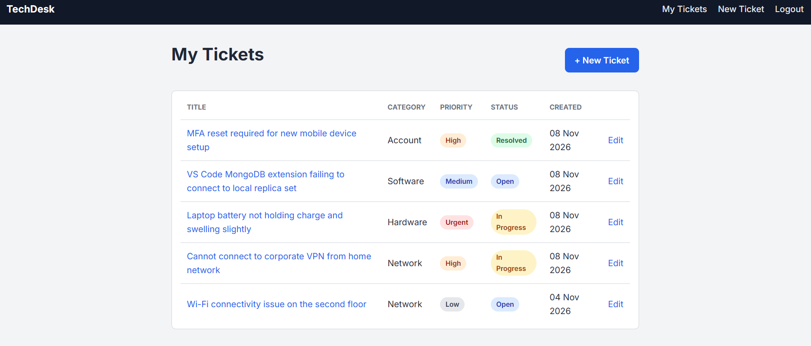

# TechDesk

**IT Support Ticket Management System**

A web application that lets users report technical issues, track support tickets, and manage their resolution status.

**Live app:** 

**Planning:** 


---

## Overview

TechDesk is a full-stack web application built with the MEN stack (MongoDB, Express, Node.js) and EJS templates. It simulates a simple IT help desk: a user creates an account, reports a technical problem as a **ticket**, follows its progress through different statuses, and adds **comments** with extra details or updates.

Each user's tickets are private. Users can only see, edit, and delete their own tickets.

This is a solo project built for the General Assembly Software Engineering Bootcamp (Unit 2).

---

## Screenshots

_Add screenshots after the pages are built. Suggested set:_

| Page | Screenshot |
|------|------------|
| Home page | `docs/screenshots/home.png` |
| Sign up / Sign in | `docs/screenshots/auth.png` |
| Tickets list | `docs/screenshots/tickets-list.png` |
| Ticket details with comments | `docs/screenshots/ticket-show.png` |
| New / Edit ticket form | `docs/screenshots/ticket-form.png` |

Example of the Markdown to use once the images exist:

```md

```

---

## Technologies Used

- **Node.js** - JavaScript runtime
- **Express.js** - web framework and routing
- **MongoDB** - database
- **Mongoose** - object data modeling and relationships
- **EJS** - server-side HTML templates
- **HTML, CSS, JavaScript** - frontend
- **express-session** and **connect-mongo** - session-based authentication
- **bcrypt** - password hashing
- **method-override** - support for PUT and DELETE from HTML forms
- **dotenv** - environment variables
- **morgan** - request logging
- **Git and GitHub** - version control
- **draw.io** - ERD and wireframes

---

## Getting Started

### Prerequisites

- [Node.js](https://nodejs.org/) installed
- A MongoDB database (local, or a free MongoDB Atlas cluster)

### Installation

1. Clone the repository:

   ```bash
   git clone <your-repository-url>
   cd techdesk
   ```

2. Install the dependencies:

   ```bash
   npm install
   ```

3. Create a `.env` file in the project root:

   ```
   MONGODB_URI=mongodb://localhost:27017/techdesk
   SESSION_SECRET=replace-with-a-long-random-string
   PORT=3000
   ```

4. Start the app:

   ```bash
   npm run dev
   ```

5. Open `http://localhost:3000` in your browser.

---

## User Stories

1. As a visitor, I want to create an account so that I can use the system.
2. As a user, I want to log in so that I can access my account.
3. As a user, I want to create a support ticket to report technical issues.
4. As a user, I want to view my tickets to track reported problems.
5. As a user, I want to edit my tickets to update issue information.
6. As a user, I want to delete my tickets when they are no longer needed.
7. As a user, I want to add comments to tickets to provide additional information.
8. As a user, I want to update and track ticket status to monitor issue resolution.

---
