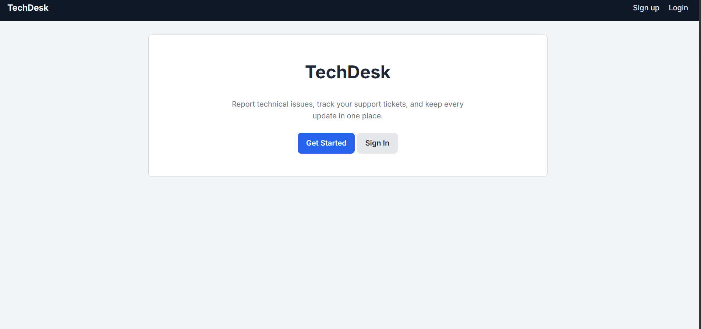
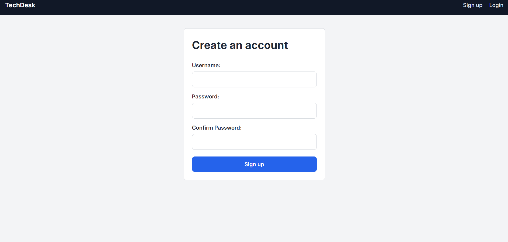
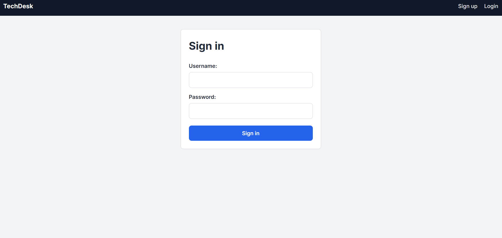
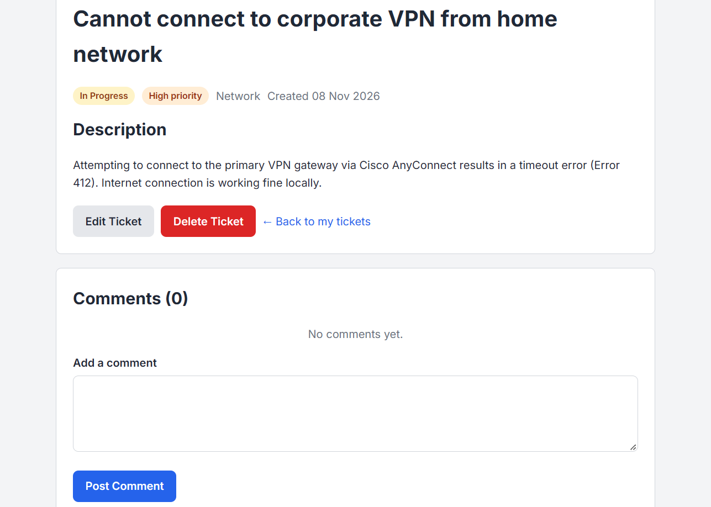
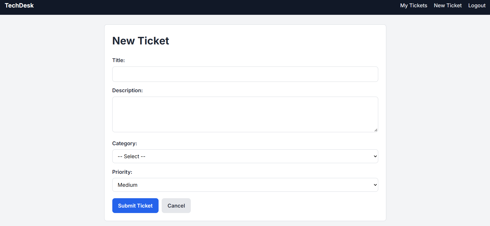
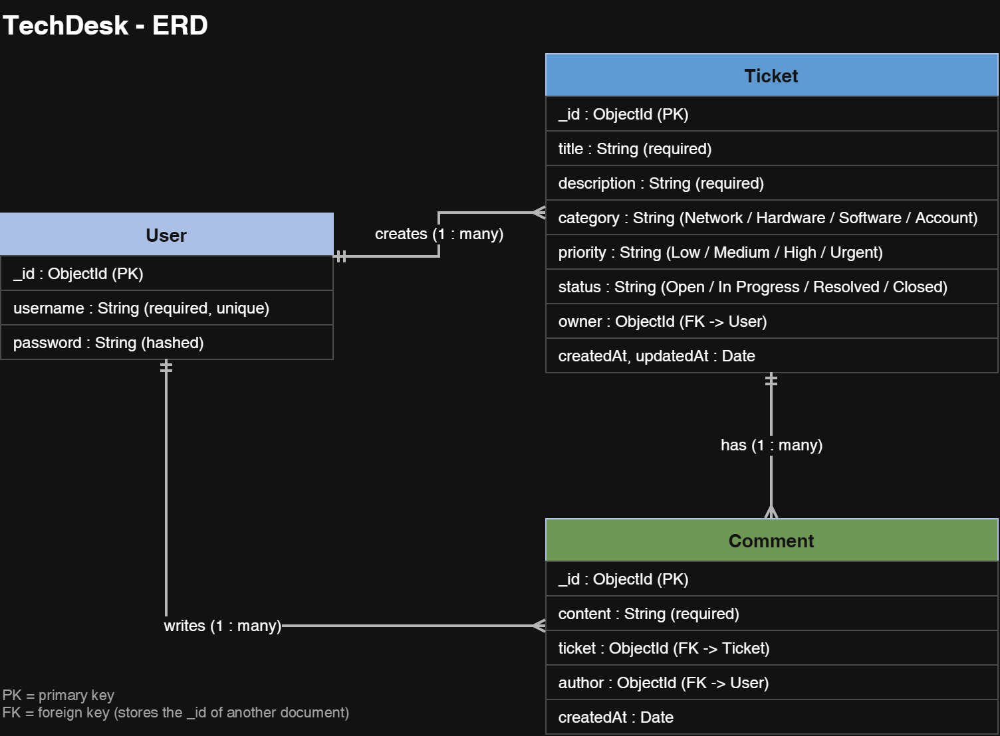
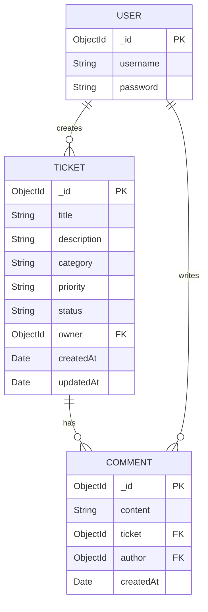

# TechDesk

**IT Support Ticket Management System**

A web application that lets users report technical issues, track support tickets, and manage their resolution status.

**Live app:** https://techdesk-d3s7.onrender.com/

**Planning:** https://trello.com/b/LctnAPY8


---

## Overview

TechDesk is a full-stack web application built with the MEN stack (MongoDB, Express, Node.js) and EJS templates. It simulates a simple IT help desk: a user creates an account, reports a technical problem as a **ticket**, follows its progress through different statuses, and adds **comments** with extra details or updates.

Each user's tickets are private. Users can only see, edit, and delete their own tickets.

This is a solo project built for the General Assembly Software Engineering Bootcamp (Unit 2).

---

## Screenshots

### Home page
<p align="center">
  
</p>
 
### Sign up and sign in
<p align="center">
  
  
</p>
 
### Tickets list
<p align="center">
  
</p>
 
### Ticket details with comments
<p align="center">
  
</p>
 
### New and edit ticket forms
<p align="center">
  
</p>


---

## Technologies Used

- **Node.js** - JavaScript runtime
- **Express.js** - web framework and routing
- **MongoDB** - database
- **Mongoose** - object data modeling and relationships
- **EJS** - server-side HTML templates
- **HTML, CSS, JavaScript** - frontend
- **express-session** and **connect-mongo** - session-based authentication
- **bcrypt** - password hashing
- **method-override** - support for PUT and DELETE from HTML forms
- **dotenv** - environment variables
- **morgan** - request logging
- **Git and GitHub** - version control
- **draw.io** - ERD and wireframes

---

## Getting Started

### Prerequisites

- [Node.js](https://nodejs.org/) installed
- A MongoDB database (local, or a free MongoDB Atlas cluster)

### Installation

1. Clone the repository:

   ```bash
   git clone https://github.com/SjaafarAliKh/TechDesk.git
   cd TechDesk
   ```

2. Install the dependencies:

   ```bash
   npm install
   ```

3. Create a `.env` file in the project root:

   ```
   MONGODB_URI=mongodb://localhost:27017/techdesk
   SESSION_SECRET=replace-with-a-long-random-string
   PORT=3000
   ```

4. Start the app:

   ```bash
   npm run dev
   ```

5. Open `http://localhost:3000` in your browser.

---

## User Stories

1. As a visitor, I want to create an account so that I can use the system.
2. As a user, I want to log in so that I can access my account.
3. As a user, I want to create a support ticket to report technical issues.
4. As a user, I want to view my tickets to track reported problems.
5. As a user, I want to edit my tickets to update issue information.
6. As a user, I want to delete my tickets when they are no longer needed.
7. As a user, I want to add comments to tickets to provide additional information.
8. As a user, I want to update and track ticket status to monitor issue resolution.

---

## Database Design

### Entity Relationship Diagram (ERD)


 
The same diagram in text form:
 


### Models

**User**
 
| Field | Type | Notes |
|-------|------|-------|
| username | String | Required, unique |
| password | String | Required, stored hashed with bcrypt |
 
**Ticket** (full CRUD)
 
| Field | Type | Notes |
|-------|------|-------|
| title | String | Required |
| description | String | Required |
| category | String | Network, Hardware, Software, or Account |
| priority | String | Low, Medium, High, or Urgent (default: Medium) |
| status | String | Open, In Progress, Resolved, or Closed (default: Open) |
| owner | ObjectId | Reference to User |
| createdAt, updatedAt | Date | Added automatically by Mongoose timestamps |
 
**Comment**
 
| Field | Type | Notes |
|-------|------|-------|
| content | String | Required |
| ticket | ObjectId | Reference to Ticket |
| author | ObjectId | Reference to User |
| createdAt, updatedAt | Date | Added automatically by Mongoose timestamps |

### Relationships

- One **User** creates many **Tickets**.
- One **Ticket** has many **Comments**.
- One **User** writes many **Comments**.

---

## Routes

| Method | Route | Description |
|---------|-------|-------------|
| GET | / | Home page |
| GET | /auth/sign-up | Sign-up form |
| POST | /auth/sign-up | Create account |
| GET | /auth/sign-in | Sign-in form |
| POST | /auth/sign-in | Sign in |
| GET | /auth/sign-out | Sign out |
| GET | /tickets | List all of my tickets |
| GET | /tickets/new | New ticket form |
| POST | /tickets | Create ticket |
| GET | /tickets/:id | View ticket with its comments |
| GET | /tickets/:id/edit | Edit ticket form |
| PUT | /tickets/:id | Update ticket |
| DELETE | /tickets/:id | Delete ticket and its comments |
| POST | /tickets/:id/comments | Add a comment to a ticket |
 
All `/tickets` routes require the user to be signed in, and every ticket query is limited to the signed-in user's own tickets.


---

## Features

- User registration, sign in, and sign out with session authentication
- Password hashing with bcrypt
- Full CRUD on tickets (create, read, update, delete)
- Ticket category, priority, and status tracking
- Comments on each ticket, with the author and time shown
- Dates shown in the visitor's own device time zone
- Private data: users can only access their own tickets
- Protected routes for signed-out visitors
- Clean, responsive interface

---

## Future Enhancements

- Admin / technician role to manage, assign, and reply to all tickets
- Filter and search tickets by status, category, or priority
- Sort tickets by date or priority
- Edit and delete comments
- Email notifications when a ticket status changes
- File and screenshot attachments on tickets
- Dashboard with ticket statistics

---

## Credits

- Built as part of the General Assembly Software Engineering Bootcamp
- Author: _Sayed Jaafar_ - [GitHub profile](https://github.com/SjaafarAliKh)